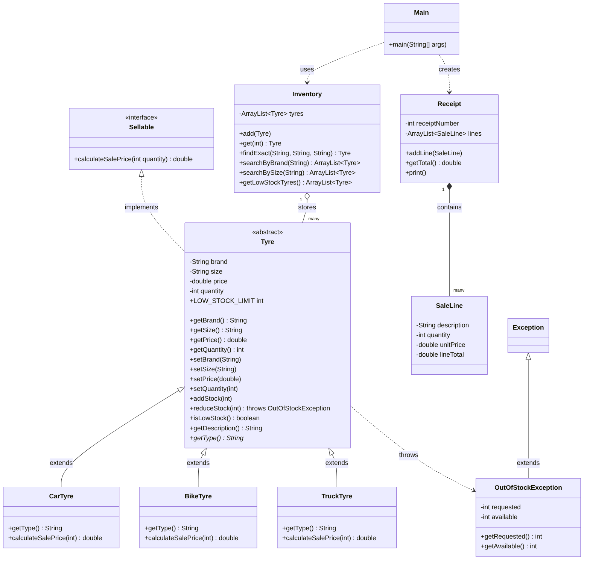

 Tyre Shop Inventory System (Java)

A console application written in Java that manages the stock of a tyre shop. It shows the four pillars of object-oriented programming in a small, realistic program. Built as Week 3 of the 8-Week Skill Assessment Plan.


What it does

- **Add stock:** add a new Car, Bike or Truck tyre, or increase the stock of a tyre that already exists
- **Sell tyres:** sell one or more items in a single sale, with automatic discounts
- **Sales receipt:** prints a receipt with the items, quantities, discount and total amount
- **View inventory:** shows every tyre in a table
- **Search:** find tyres by brand or by size (a part of the text is enough)
- **Low-stock warning:** shown whenever a tyre has fewer than 5 left (at start-up, after a sale, after adding stock and when viewing the inventory)
- **Custom exception:** `OutOfStockException` is thrown when someone tries to sell more tyres than are available
- **Input checking:** wrong input (letters instead of numbers, empty text, numbers out of range) never crashes the program

## The four OOP pillars in this project

| Pillar | Where it is used |
|---|---|
| **Encapsulation** | `Tyre` keeps brand, size, price and quantity `private`. They can only be changed through getters and setters, and the setters reject invalid values (negative quantity, price of zero or less, empty text). |
| **Inheritance** | `CarTyre`, `BikeTyre` and `TruckTyre` all extend the parent class `Tyre`, so they share its data and stock methods. |
| **Polymorphism** | Every tyre has its own `calculateSalePrice()`. The program calls `tyre.calculateSalePrice(quantity)` on a plain `Tyre` and Java automatically uses the discount rule of the real tyre type. |
| **Abstraction** | `Tyre` is an abstract class (it cannot be created directly) and `Sellable` is an interface that only says that a sale price must be calculated, not how. |

## Discount rules

| Tyre type | Discount |
|---|---|
| Car | 10% off when buying 4 or more |
| Bike | flat 5% off on every sale |
| Truck | 8% off when buying 6 or more, 3% off when buying 2 to 5 |

## Files

| File | Purpose |
|---|---|
| `Sellable.java` | Interface with `calculateSalePrice(int quantity)` |
| `Tyre.java` | Abstract parent class (brand, size, price, quantity, stock methods) |
| `CarTyre.java`, `BikeTyre.java`, `TruckTyre.java` | Subclasses, each with its own discount rule |
| `OutOfStockException.java` | Custom exception |
| `Inventory.java` | Stores the tyres in an `ArrayList` and handles find and search |
| `SaleLine.java` | One line of a receipt |
| `Receipt.java` | Collects the sale lines and prints the receipt |
| `Main.java` | The console menu |
| `class_diagram.png` | Class diagram of the project |
| `sample_output.txt` | A sample run of the program |

## Class diagram



## How to run

1. Install a JDK (Java Development Kit), for example Eclipse Temurin from adoptium.net. Keep the installer's default options, which add Java to PATH.
2. Open a new Command Prompt in the project folder and check that Java works:
   ```
   javac -version
   ```
3. Compile all the files:
   ```
   javac *.java
   ```
4. Run the program:
   ```
   java Main
   ```

Some sample tyres are loaded when the program starts, so you can try selling straight away. The inventory is kept in memory only, so changes are not saved when the program closes.

## Menu

1. Add Stock
2. Sell Tyres
3. View Inventory
4. Search by Brand or Size
5. Exit


